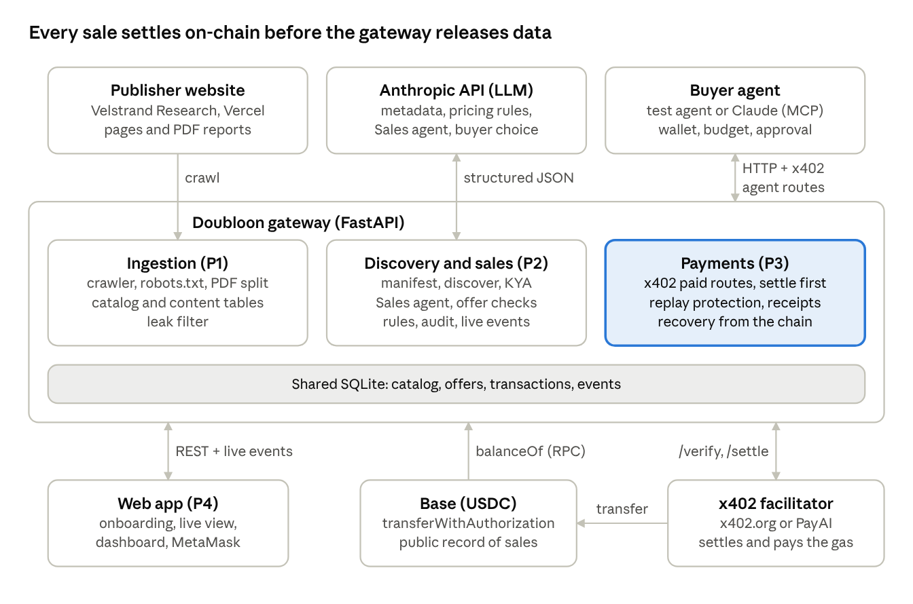

# Technical Documentation: Doubloon

18 October 2026 · Maximilien Rambaud

## Overview

Doubloon turns any website into data that AI agents can discover, negotiate for and pay for in USDC, with the price set by what the agent asks for: one figure for 0.10 USDC, a small table for 0.50, a full report section for 2.00.

- **Competition topic.** International Track, Topic F (Agent Wallet). Two AI agents act as financial participants: a buyer agent that holds a wallet and spends under limits set by its owner, and a Sales agent that prices and sells data for the publisher.
- **Publisher side.** Paste a URL, review the scanned catalog (sell, free or private), write prices in plain words, connect a wallet, go live. About 60 seconds, no code.
- **Buyer side.** Read the signed manifest, prove wallet ownership (KYA), negotiate with the Sales agent, pay through x402, receive the data after on-chain settlement with a signed license receipt.
- **Compliance.** Both sides screen wallets against the OFAC sanctions list, every event goes into a SHA-256 audit chain, and conversations are erased after 30 days while financial records are kept.
- **What runs today.** The full flow on a simulated publisher, Velstrand Research ([velstrand-research.vercel.app](https://velstrand-research.vercel.app)), with 25 settled payments on Base Sepolia and 2 on Base mainnet in real USDC. A buyer can be our test agent or anyone's own Claude through an MCP connector.

Repository: [github.com/xamalow/FinHack](https://github.com/xamalow/FinHack). Security details are in the separate [Security Self-Assessment Report](SECURITY_SELF_ASSESSMENT.md).

## System architecture

One FastAPI gateway hosts every server component and one SQLite file holds all state. External parties are the publisher's site, the buyer agent, the Anthropic API, the x402 facilitator and the Base blockchain.



The buyer reaches the gateway over HTTP with x402 headers; the gateway asks the facilitator to verify and settle each payment on Base before it releases any content. Sanctions screening reads the Chainalysis oracle on Ethereum mainnet through a public RPC.

| Role | Owns | Folders |
| --- | --- | --- |
| P1, publisher data | Simulated site, crawler, catalog, leak filter, scan endpoints | `site-demo/`, `ingestion/` |
| P2, gateway and Sales agent | App entry point, shared schemas, database and events, discovery, KYA, Sales agent, offers, rules, audit, event stream | `gateway/`, `shared/` |
| P3, payments, buyer and compliance | x402 paid routes, replay protection, receipts, recovery, balances, stats, test buyer agent, MCP connector, wallet scripts; compliance layer (sanctions, audit chain, signing, watermark, retention, keystores, owner access) | `payments/`, `buyer-agent/`, `buyer-mcp/`, `scripts/`, `shared/` compliance modules |
| P4, interfaces and demo | Onboarding, live view, dashboard, demo run sheet | `frontend/` |

Every step of every workflow calls `log_event()`. The live view and the audit trail are built only from these events, so what the screen shows is what happened.

## Core algorithms

The design rule throughout: an LLM may propose, but only deterministic code decides anything that touches price, permission or money.

### 1. Catalog building (ingestion)

1. Read `sitemap.xml`, respect `robots.txt` (`urllib.robotparser`), fetch HTML pages and PDF reports (httpx, BeautifulSoup, PyMuPDF). Every request, redirects included, must go to an http(s) host that resolves to public addresses only, so a scan cannot reach localhost, the LAN or a cloud metadata endpoint.
2. Split each report into sections. Each section becomes one catalog item: `content_id`, report, title, section, topic, region, period, data types, sensitivity, status, suggested tier.
3. One LLM call per section writes the metadata (heuristics when `INGESTION_LLM=off`). Raw text goes to the `content` table, metadata to `catalog`. The catalog never holds a figure.
4. Pages that look internal (for example "Internal notes") are flagged `excluded`. A flagged item returns 409 if the publisher tries to make it sellable.

### 2. Pricing rules to tiers

1. The publisher writes rules in natural language. An LLM with structured output maps each price level to one of three tiers: `single_fact`, `small_table`, `full_section`.
2. Code rounds each price and derives its paid route from the price in cents (0.10 → `t010`, 0.50 → `t050`, 2.00 → `t200`). A price with no route, or a duplicate tier, is refused with 422.
3. If the LLM is unavailable, a deterministic parser reads lines such as `$0.50: a small table`.
4. The publisher confirms the table. From then on every check reads the confirmed table, never the raw text.

### 3. Sales agent: LLM proposal, deterministic decision

Each buyer message is one turn of `POST /session/message`:

1. Build the prompt from catalog metadata (excluded items removed), confirmed tiers, publisher rules, today's paid purchases of this wallet, the conversation so far and the buyer message. Buyer text sits inside tags, any section tags it contains are escaped, and it is declared untrusted. The Sales agent never sees paid content.
2. Call the LLM with a fixed system prompt and a JSON schema: `action` (ask_clarification, propose_offer, no_match, refuse), `message_to_buyer`, optional `offer`, `injection_detected`.
3. Validate in code:
   - the tier exists in the confirmed table and the price equals the tier price exactly;
   - the tier is not below the suggested tier of the content it sells;
   - the offer covers exactly one `content_id`, and that item is `sellable`;
   - the daily limit holds: at most 3 sections of one report per wallet per day, counting paid offers and accepted offers still inside their 300 s payment window, checked again at `/offer/accept`;
   - the leak filter finds no paid figure in the message or the offer scope;
   - at most one clarifying question per session.
4. On failure, retry once with the errors as feedback. A second failure returns a safe refusal. A rejected offer never reaches the buyer.
5. A valid offer is stored as `proposed` with a 300 s expiry. Injection attempts (regex or the LLM's own flag) are logged as `injection_ignored`. A session accepts at most 6 buyer messages.

### 4. KYA: Know Your Agent

1. `POST /kya/challenge` returns a 32-byte random nonce, valid 120 s, tied to the declared agent id and wallet.
2. The agent signs the nonce with EIP-191. `POST /kya/verify` consumes the nonce atomically (single use), recovers the signer with `eth_account` and checks it equals `X-Agent-Wallet`.
3. An agent id stays bound to its first wallet (checked first). The wallet is then screened against a local blocklist and the OFAC SDN list through the Chainalysis oracle (`isSanctioned`, cached 1 h; fail closed on mainnet, open on testnet).
4. Success issues an HS256 JWT valid 15 minutes. Every later request must carry it with the same `X-Agent-Id` and `X-Agent-Wallet`.

### 5. x402 payment, settled before delivery

1. `POST /offer/accept` moves the offer to `accepted` (only from `proposed`, only before expiry, daily limit re-checked) and returns its route.
2. `POST /query/{route}` without payment answers 402. The `PAYMENT-REQUIRED` header is rebuilt server-side from the confirmed tier price and the publisher wallet; the client amount is never trusted.
3. The buyer checks the invoice in code, then signs an EIP-3009 `TransferWithAuthorization` (exact amount, recipient, 120 s window, random 32-byte nonce). The facilitator pays the gas.
4. The gateway requires the payer to be the wallet verified at KYA, screens it again for sanctions, reserves `(nonce, offer_id)` under UNIQUE constraints, then calls the facilitator `/verify` and `/settle`.
5. Only after settlement: mark the offer `paid`, load the purchased content, add a per-buyer watermark (a visible license line and an invisible HMAC id), sign a license receipt (tx, payer, amount, license, SHA-256 of the content), and return 200 with a `PAYMENT-RESPONSE` header carrying the transaction hash.
6. Recovery: if the process fails between the on-chain transfer and the database write, the next request asks the USDC contract (`authorizationState`, `AuthorizationUsed` logs) and delivers to the same payer. `GET /receipt/{tx_hash}` re-delivers for 24 hours with the same marks and receipt.

### 6. Leak filter

`contains_paid_figures(text)` builds the set of numbers found in sellable and excluded content, minus numbers that are public anyway: those in free content, years and small integers 0 to 10. Text is normalised first (NFKC, invisible characters removed, Arabic separators mapped). Numbers are then compared by value, so 31.4, 31,4, 31.40 and 31.4% match, as do 17,340, 17 340 and 17.340. It runs on discovery results and on every Sales agent message.

### 7. Buyer agent decision

1. On first contact, check the manifest signature and pin the publisher signer (trust on first use, or `BUYER_TRUSTED_SIGNERS`); later, a changed, re-signed or unsigned manifest is refused.
2. Before the LLM sees an offer, code checks: price ≤ remaining budget (5.00 USDC), price ≤ per-purchase cap (2.50), price ≤ approval threshold (1.00), otherwise it pauses for the owner. A per-wallet spend ledger adds 25 USDC per day and 20 purchases per hour; 3 purchases in 24 h at 80 to 100% of the threshold force an approval (structuring detection).
3. The LLM proposes accept, refuse or counter (at most 3 rounds). Its output is a JSON schema; an error or refusal means refuse.
4. Before signing, code checks the 402: one option, scheme `exact`, the expected network and USDC asset, `payTo` equal to the manifest wallet and not sanctioned, amount equal to the offer price.
5. The x402 client has its own ceiling (`max_amount_per_payment`), a second rail if our code had a bug.
6. After delivery, the buyer verifies the license receipt signature and that its tx hash, payer and amount match its own payment.

The MCP connector (`buyer-mcp/`) applies the same checks when someone's own Claude is the buyer.

### 8. Compliance layer

- **Audit chain.** Each event is chained in the same database transaction that stores it, so editing, deleting or inserting an event breaks the chain from that point. `GET /compliance/audit-head` publishes the latest hash; `scripts/anchor_audit.py` can write it on-chain.

  `h_i = SHA256(h_(i-1) || event_id_i || SHA256(event_i))`

- **Signing.** One publisher key signs the manifest and every license receipt with EIP-191 over canonical JSON and a domain line, so any Ethereum library can verify them offline.
- **Watermark.** The receipt id is an HMAC-SHA256 of (offer, payer), 48 bits, written as a visible license line and in zero-width characters; `POST /compliance/trace` maps a leaked text back to its sale.
- **Retention.** At start and on request, conversations older than 30 days (or of one wallet, on an erasure request) are deleted and their event text replaced; the chain keeps the hash, so it still verifies. Offers, transactions and receipts are kept as financial records.

## Security design

Security rests on five principles, each enforced in code. The permission tiers, controls and known-risk list are in the [Security Self-Assessment Report](SECURITY_SELF_ASSESSMENT.md).

- **LLMs have no authority.** Sales agent and buyer LLM outputs are proposals checked by deterministic code (tier, exact price, tier floor, sellable content, daily limit, leak filter, budget, cap, velocity, approval threshold).
- **The seller never sees what it sells.** The Sales agent works from metadata only; paid content is loaded once, after settlement, for the buyer who paid.
- **Money moves before data, only once, and only between screened parties.** The amount is fixed server-side, the payer must be the KYA wallet, both sides are screened against OFAC, `(nonce, offer_id)` is unique, settlement happens on-chain before delivery, and a lost delivery is recovered from the chain.
- **Configuration and buyer data belong to their owner.** Publisher setup, dashboards with buyer data and buyer controls accept only loopback callers or an owner token.
- **Everything is visible and provable.** Every step emits an event with secrets masked, chained by SHA-256; each sale ends with a signed license receipt.

## Data model and API

One SQLite file shared by every component (`shared/db.py`, `DB_PATH`). Tables are created on the first connection.

| Table | Owner | Holds |
| --- | --- | --- |
| `catalog` | ingestion | One row per section: metadata, status (`sellable`, `free`, `excluded`), suggested tier |
| `content` | ingestion | Raw text per section, read only at delivery |
| `rules` | gateway | Natural-language rules, generated tiers, confirmed flag |
| `publisher` | gateway | Name, site URL, wallet, activation time |
| `agents`, `kya_challenges`, `sessions` | gateway | Agent id bound to wallet and status; single-use nonces; sessions with expiry and round count |
| `messages`, `offers` | gateway | Conversation (erased after 30 days); offers with tier, price, status, expiry |
| `transactions`, `license_receipts` | payments | Payer, payee, amount, EIP-3009 nonce (unique), offer (unique), tx hash, status; signed receipt per sale |
| `events`, `audit_chain` | all | Timestamp, session, actor, type, summary, masked payload; content hash and chain hash per event |

| Endpoint | Caller | Purpose |
| --- | --- | --- |
| `GET /.well-known/ai-data.json` | agent | Signed manifest: publisher, gateway, topics, x402 network and `pay_to`, signer |
| `GET /discover?q=` | agent | Free summary of topics, periods, tiers and items, never a figure |
| `POST /kya/challenge`, `POST /kya/verify` | agent | Wallet-signature identity and sanctions check, 15-minute session token |
| `POST /session/message` | agent | One turn with the Sales agent |
| `POST /offer/accept` | agent | Lock an offer for 300 s, get its paid route |
| `POST /query/{route}` | agent | x402-protected delivery (`t010`, `t050`, `t200`) with watermark and signed receipt |
| `GET /receipt/{tx_hash}` | agent | Re-download within 24 h, same payer |
| `GET /compliance/audit-head`, `/compliance/signer`, `POST /compliance/verify-receipt` | anyone | Latest chain hash, publisher signer, receipt check |
| `POST /publisher/scan`, `GET` and `PATCH /publisher/catalog` | publisher owner | Crawl, review, set status |
| `PUT /publisher/rules`, `POST /publisher/rules/confirm`, `/wallet`, `/activate` | publisher owner | Pricing, payout wallet, go live |
| `GET /audit/{offer_id}`, `/transactions`, `/publisher/stats`, `/events`, `/events/stream` | publisher owner | Audit trail, sales, revenue, event history and live Server-Sent Events |
| `GET /compliance/audit-chain`, `/report`, `/screen/{address}`, `POST /compliance/trace`, `/purge`, `/erase` | publisher owner | Full chain check, auditor report, on-demand screening, leak trace, retention and erasure |
| `POST /buyer/run`, `/buyer/approve` | buyer owner | Start the test agent, approve a purchase above the threshold |
| `GET /balance/{address}` | anyone | On-chain USDC balance |

"Owner" means a loopback caller, or the `X-Owner-Token` header matching `PUBLISHER_OWNER_TOKEN` or `BUYER_OWNER_TOKEN`.

Agents send `X-Agent-Id` and `X-Agent-Wallet` on every request, plus `Authorization: Bearer <token>` after KYA. Interactive API docs: `/docs` on a running gateway.

## Deployment

Requirements: Python 3.11+, Node 20+, an Anthropic API key, and test USDC on Base Sepolia for the buyer wallets ([faucet.circle.com](https://faucet.circle.com)).

```bash
# 1. Backend
python3.11 -m venv .venv
.venv/bin/pip install -r requirements.txt -r payments/requirements.txt -r ingestion/requirements.txt
cp .env.example .env                        # set JWT_SECRET (32+ chars) and ANTHROPIC_API_KEY
.venv/bin/python scripts/create_wallets.py  # publisher + 4 buyer wallets, then fund the buyers
.venv/bin/python scripts/encrypt_keys.py --apply --rewrite-env   # move keys to encrypted keystores
.venv/bin/python scripts/check_funds.py
.venv/bin/uvicorn gateway.main:app --port 8000

# 2. Simulated publisher site (or use https://velstrand-research.vercel.app)
.venv/bin/python site-demo/serve.py --port 8001   # local scan needs SCAN_ALLOW_PRIVATE_HOSTS=1

# 3. Web app
cd frontend && npm install
NEXT_PUBLIC_GATEWAY_URL=http://localhost:8000 npm run dev   # http://localhost:3000

# 4. Before a demo
.venv/bin/python scripts/preflight.py       # config, gateway, catalog, facilitator, RPC, balances, audit chain
```

| Setting | Testnet (default) | Mainnet |
| --- | --- | --- |
| `NETWORK` | `eip155:84532` (Base Sepolia) | `eip155:8453` (Base) |
| `USDC_ADDRESS` | `0x036CbD53842c5426634e7929541eC2318f3dCF7e` | `0x833589fCD6eDb6E08f4c7C32D4f71b54bdA02913` |
| `FACILITATOR_URL` | `https://x402.org/facilitator` | `https://facilitator.payai.network` |
| How | `.env` | `.env.mainnet`, commands prefixed with `scripts/mainnet.sh` |

Secrets (`JWT_SECRET`, API keys, owner tokens) live in `.env`, which git ignores; private keys go to encrypted keystores with the password in the OS keychain (`KEYSTORE_PASSWORD` where there is none). Set `PUBLISHER_OWNER_TOKEN` and `BUYER_OWNER_TOKEN` to manage the gateway from another machine; without them, setup and dashboards answer only on loopback. Sanctions screening reads `SANCTIONS_RPC_URL` (Ethereum mainnet). To use your own Claude as a buyer, add `buyer-mcp/server.py` to Claude Desktop or Claude Code (see `buyer-mcp/README.md`).

## Testing and execution evidence

159 automated tests cover the system, and 27 real payments are on public block explorers. On a clean Windows checkout on 18 Oct, 157 pass; the 2 others depend on the machine (a Unix file mode, a `PUBLISHER_WALLET_ADDRESS` in `.env`) and pass on P3's setup.

| Suite | Tests | Covers |
| --- | --- | --- |
| `gateway/tests` | 54 | Human redirect, KYA (wrong signer, replayed nonce, blocklist, OFAC), token bound to headers, offer validation (price, tier floor, excluded content, leak, daily limit), injection, LLM outage, onboarding, owner-only routes, audit chain, receipts, retention, security headers |
| `ingestion/tests` | 52 | Crawl of the live site, robots.txt, SSRF refusal, PDF sections, internal page flagging, leak filter formats and Unicode |
| `payments/tests` | 21 | Owner-only buyer controls, recovery from the chain, rate limit, watermark, keystores |
| `buyer-agent` | 26 | Budget, cap, approval, daily and hourly caps, structuring, tampered 402, manifest signer pinning, receipt check |
| `buyer-mcp/tests` | 5 | Connector approval order, sanitised seller text, on-chain balance |

The gateway tests replace the LLM with scripted outputs, so they need no API key. End-to-end scripts run against a live gateway and the chain: `payments/e2e_query.py` (15 checks), `payments/e2e_buyer.py` (22), `payments/e2e_balances_stats.py` (10), `payments/e2e_recovery.py` (7) and `buyer-mcp/e2e_mcp.py` (13/13 on Base Sepolia with live sanctions screening).

| Network | Scenario | Amount | Transaction |
| --- | --- | --- | --- |
| Base mainnet | Full product: KYA, Sales agent, LLM decision, code guards, delivery after settlement | 0.10 USDC | [0xc70ea04371…](https://basescan.org/tx/0xc70ea043716023f1e76ef26dac5e27c814d51ae0ca541d797ee249c949d36f8f) |
| Base mainnet | x402 paid route | 0.01 USDC | [0x695cf3bb3a…](https://basescan.org/tx/0x695cf3bb3a354d623890ba7f87d3809ca5a607e326f33905dca0b44723e0e250) |
| Base Sepolia | All four roles merged, real catalog: one figure | 0.10 USDC | [0x010654b9f1…](https://sepolia.basescan.org/tx/0x010654b9f196a7edf5fb382f3b840a8e1bf2b749756f811f8e2a132eaab830c4) |
| Base Sepolia | All four roles merged: full section after human approval | 2.00 USDC | [0xb59df8f649…](https://sepolia.basescan.org/tx/0xb59df8f6496f54d360c487d052cc10fa888a9cb6b97664d1fe2a8552050d80ea) |
| Base Sepolia | Real gateway and Sales agent: one figure | 0.10 USDC | [0x2185e54ad0…](https://sepolia.basescan.org/tx/0x2185e54ad0a5644acf94fd04b8142595eccabae6055fd9a3fb64052486bb2a6f) |
| Base Sepolia | First x402 payment | 0.01 USDC | [0xa1ca62f97b…](https://sepolia.basescan.org/tx/0xa1ca62f97bca90ec70f63d9ea486aa060ae5bf02bcccc88b981b65ef6c89a3dd) |

The full list (25 Base Sepolia payments, 15.71 test USDC) is read from the chain's USDC `Transfer` logs, not from our database: [`payments/docs/ONCHAIN_EVIDENCE.md`](../payments/docs/ONCHAIN_EVIDENCE.md).

## Limitations and future work

- **Agents buy on our gateway, not on the publisher's domain.** Next: an edge proxy and rewrites on the publisher site so the 402 comes from the publisher's own URL; in production a DNS proxy or a plugin (WordPress, Next.js, Cloudflare Worker).
- **Agents are recognised by declaring themselves.** An undeclared bot is treated as a human and can read public pages. Next: accept signed requests (Web Bot Auth) next to wallet KYA, and keep premium content off public pages.
- **Paid PDFs are public on the demo site** because the crawler reads them there. Next: upload or private URL for the scan.
- **Domain ownership** is not verified at onboarding.
- **Granularity.** The smallest sold unit is a report section, so a 0.10 "one figure" sale delivers a paragraph with several figures. Next: atomic fact items.
- **Keys.** Encrypted keystores are in place on one machine; `.env.mainnet` and the other machines still need migrating, and production needs a KMS or server wallet.
- **Trust and screening.** The manifest signer is trusted on first use; sanctions screening covers OFAC only, through a free oracle; the audit head is not yet anchored on-chain.
- **One facilitator per network**, and approvals and rate-limit counters live in memory (lost on restart, per process).
- **Out of scope:** refunds and disputes, platform commission, multi-publisher marketplace, protection against rebuilding a report from many wallets beyond the daily limit.
