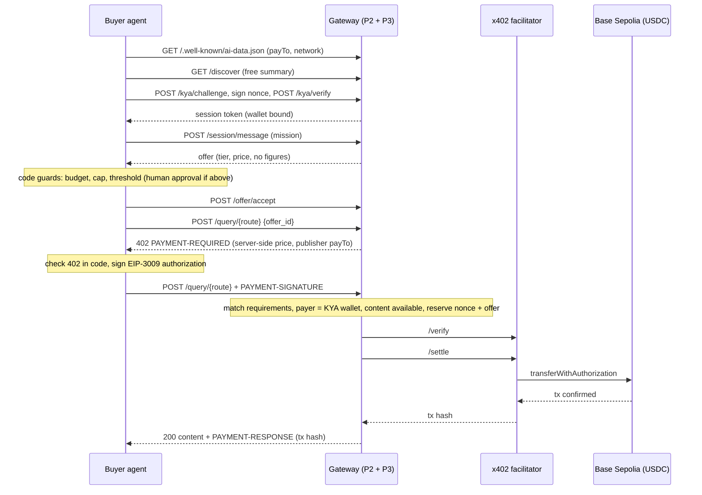

# Payments and buyer agent (P3): technical documentation

Part of the agent storefront: a publisher's content is sold piece by piece to AI agents, paid in USDC through the x402 protocol on Base Sepolia. This document covers the payment layer (`payments/`), the autonomous buyer agent (`buyer-agent/`) and the wallet scripts (`scripts/`). Security is detailed in [SECURITY_P3.md](SECURITY_P3.md), transactions in [ONCHAIN_EVIDENCE.md](ONCHAIN_EVIDENCE.md).

## 1. Components

```
buyer-agent/agent.py      autonomous buyer: own wallet, budget, LLM decision, code guards, x402 client
payments/router.py        POST /query/{route}, GET /receipt/{tx_hash}, GET /transactions,
                          GET /balance/{address}, GET /publisher/stats
payments/buyer_router.py  POST /buyer/run, POST /buyer/approve, GET /buyer/runs/{id}, POST /buyer/replay-last
payments/x402_server.py   x402 resource server (facilitator client, requirement builder)
payments/store.py         SQLite: transactions (UNIQUE nonce, UNIQUE offer_id), paid_route_requests
payments/balances.py      USDC balanceOf + per-session watcher emitting balance_changed
payments/deps.py          the only bridge to P1/P2 code (gateway.integration), mocks when absent
scripts/                  create_wallets.py, check_funds.py
```

Both routers are mounted in the single gateway app (`gateway/main.py`, P2). The buyer agent talks to the gateway only over HTTP, like any external agent would.

| Item | Value |
|---|---|
| Protocol | x402 v2, scheme `exact`, Python SDK `x402==2.25.0` |
| Network / asset | Base Sepolia `eip155:84532`, USDC `0x036CbD53842c5426634e7929541eC2318f3dCF7e` (6 decimals) |
| Settlement | EIP-3009 `transferWithAuthorization`, gas paid by the facilitator (`https://x402.org/facilitator`) |
| Prices | confirmed publisher tiers: `t010` 0.10 (one figure), `t050` 0.50 (small table), `t200` 2.00 (full section) |
| Buyer LLM | Anthropic API, `messages.parse` with a Pydantic schema (structured output), low effort |

## 2. End-to-end sequence



## 3. Algorithms

### 3.1 Paid route `POST /query/{route}`

1. **Session**: Bearer token resolved to `{session_id, agent_id, wallet_address}` (JWT from KYA, P2).
2. **Offer checks**: belongs to the session, status `accepted`, not expired, route matches tier, offer price equals the confirmed tier price. Already paid → 409.
3. **Content check**: `get_content(content_ids)` must succeed (exists, not excluded). Otherwise 409, no 402 is ever sent.
4. **No payment header** → build the requirements from server data only (`amount = tier price × 10^6`, `payTo = publisher wallet`, 120 s validity), answer 402 with `PAYMENT-REQUIRED`, and start the balance watch for the buyer and publisher wallets.
5. **Payment header** → decode, then:
   - the payload must match the server requirements field by field, otherwise 402;
   - `authorization.from` must equal the session's KYA wallet, otherwise 402;
   - the content is checked again and loaded (kept in memory);
   - `(nonce, offer_id)` is inserted as `pending` with UNIQUE constraints; a duplicate means replay → 409.
6. **Facilitator**: `/verify` (signature, balance, validity window), then `/settle` (on-chain transfer, waits for confirmation). Broadcast failures are retried up to 3 times. Any failure releases the reservation and delivers nothing.
7. **After settlement only**: row → `settled` with tx hash, offer → `paid`, answer 200 with the preloaded content, the receipt and `PAYMENT-RESPONSE`.

Every step emits an event (`payment_required_sent`, `verify_response`, `payment_verified`, `settle_response`, `payment_settled`, `tx_confirmed`, `content_delivered`, `replay_rejected`, `payment_rejected`) for the live view.

### 3.2 Buyer agent decision pipeline

```
mission + budget
  → manifest (payTo, network) → discover → KYA signature → session
  → loop, max 3 rounds:
       Sales agent reply
       if offer: hard limits in code (budget, cap)          → over: refuse (offer_refused_budget)
       LLM decision (accept / refuse / counter), untrusted seller text as data
       accept: threshold in code                            → above: wait for human approval
  → /offer/accept → 402 → check 402 in code (scheme, network, asset, payTo = manifest, amount = offer)
  → sign EIP-3009 → pay → store receipt, update budget
```

Without `ANTHROPIC_API_KEY` the LLM step falls back to a deterministic rule (accept if it fits the budget, answer clarifications with the mission). Every money decision stays in code either way.

### 3.3 Balances and stats

- `GET /balance/{address}`: `balanceOf` on the USDC contract through the public RPC.
- On each 402, a watcher for the session reads the buyer and publisher balances (baseline), then polls every 2 s for 120 s and emits `balance_changed` with `role`, `delta_atomic`, `balance_usdc`. The baseline is taken before payment, so the live view shows the transfer as it lands.
- `GET /publisher/stats`: requests on paid routes, paid requests, revenue, average sale, unique payers, sales by price (settled transactions only).

## 4. Data model (P3 tables)

| Table | Columns | Notes |
|---|---|---|
| `transactions` | tx_id, offer_id (UNIQUE), payer, pay_to, amount_atomic, nonce (UNIQUE), tx_hash, status (`pending`/`settled`), ts | replay protection lives in the two UNIQUE constraints |
| `paid_route_requests` | ts, route, offer_id, session_id, status_code | feeds `/publisher/stats` |

Both live in the shared SQLite file (`DB_PATH`), next to P2's tables.

## 5. Configuration

| Variable | Default | Use |
|---|---|---|
| `NETWORK`, `USDC_ADDRESS`, `RPC_URL`, `FACILITATOR_URL`, `EXPLORER_URL` | Base Sepolia values | chain and facilitator |
| `PUBLISHER_WALLET_ADDRESS` | from onboarding | payTo fallback |
| `BUYER_PRIVATE_KEY_1..4` | generated by `scripts/create_wallets.py` | buyer wallets (`.env` only) |
| `BUYER_BUDGET_USDC`, `BUYER_MAX_PER_TX_USDC`, `BUYER_APPROVAL_THRESHOLD_USDC` | 5.00, 2.50, 1.00 | permission tiers |
| `BUYER_MANIFEST_URL` | `http://127.0.0.1:4022/.well-known/ai-data.json` | where the buyer starts |
| `RECEIPT_TTL_HOURS`, `DB_PATH`, `ANTHROPIC_API_KEY` | 24, `finhack.db`, none | receipts, storage, buyer LLM |

Switching to mainnet: change `NETWORK`, `USDC_ADDRESS`, `FACILITATOR_URL` (CDP, with keys) and fund the wallets. The code is unchanged.

## 6. Run and test

```bash
uv venv --python 3.11 .venv
uv pip install --python .venv/bin/python -r requirements.txt -r payments/requirements.txt
.venv/bin/python scripts/create_wallets.py     # then fund buyers at faucet.circle.com (Base Sepolia USDC)
.venv/bin/python scripts/check_funds.py

.venv/bin/uvicorn gateway.main:app --port 8000          # full product (P1 + P2 + P3)
# or P3 alone on mocks: .venv/bin/uvicorn payments.dev_app:app --port 4022

.venv/bin/python -m pytest buyer-agent -q
GATEWAY_URL=http://127.0.0.1:8000 .venv/bin/python payments/e2e_buyer.py
GATEWAY_URL=http://127.0.0.1:8000 E2E_WALLET=2 .venv/bin/python payments/e2e_balances_stats.py
.venv/bin/python payments/e2e_query.py                  # needs dev_app (uses /dev/offer)
```

Against the gateway, run the publisher onboarding first (rules → confirm, wallet, activate), since the manifest is 404 until activation. Use one buyer wallet per scenario: the Sales agent will not re-sell a section the same agent already bought today.
